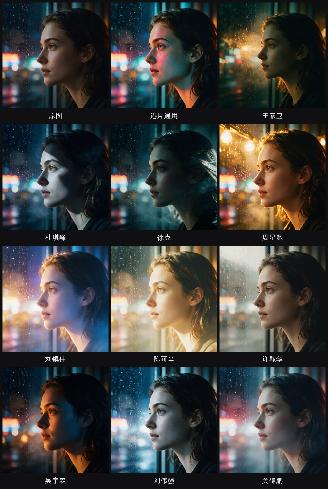

# HK Cinema Style · 港片导演视觉风格参考（图片/视频通用）

港片黄金年代导演影像语言参考库 + 调用纪律（SKILL.md 格式，适配 Hermes Agent / Claude Code 等支持技能加载的宿主）。

**覆盖五种工作模式**：A 文生图 · B 改图（i2i 风格迁移）· C 局部精修（精准编辑/图层拆分）· D 系列批量 · E 视频（文生视频/视频风格化，含每导演运动语法）。

**边界声明：本技能只是视觉风格参考，不介入创意**——题材、构图、文案、叙事由用户决定，技能不主动改创意、不扩写题材、不替用户决定画什么/拍什么。

核心资产是 `references/hk-director-styles.md` —— 一份港片导演影像风格库：

- **1 个港片通用语法**（黄金年代总风格：三色混光——钠灯橙黄 × 荧光青白 × 霓虹红品红，富士胶片颗粒，旧而闹、有人味）
- **10 位导演固定语法**：王家卫、杜琪峰、徐克、周星驰、刘镇伟、陈可辛、许鞍华、吴宇森、刘伟强、关锦鹏
- 每位三层结构：**固定生产语法**（色盘/光/手法元素/力度/肤色/易混判别/禁项/一句话）+ **分片深度参考** + **景别语法**（特写、中景、大景、夜景、雨雾分别怎么处理）
- **选型决策表**（什么画面内容配什么导演）+ **文字/品牌元素风险等级表**（海报改图的文字保护对策）

## 解决的问题

用生图模型给成品海报/照片改风格时的典型翻车：

- 风格把画面细节洗没、文字改错字（"为了风格而风格"）
- 同一导演被学成一两部片子的单一色调（"全是墨绿+酒红"）
- 系列图每张参考不同片子，风格漂移
- 风格色染到产品本体（车漆变金箔）

本技能的纪律：**语法定语言，景别定造句**——冻结导演的词汇与色盘架构，按每张图的内容从语法里选用手法；风格只做气质引导，文字/产品/构图逐字逐项锁死。

## 效果示意

同一张特写原图 → 11 种风格（注意不只是调色：烟雾/光晕/焦点分离/肤质处理均按各导演语法入场）：



## 安装

**方式 ① 一键安装**（macOS/Linux，自动探测 Hermes/Claude/Codex 技能目录，装完直接打印给 Agent 的接入口令）：

```bash
curl -fsSL https://raw.githubusercontent.com/liusencomic-cyber/hk-cinema-style/main/install.sh | bash
```

**方式 ② 下载 zip**（不用 git、不懂命令行也行）：[下载 hk-cinema-style-main.zip](https://github.com/liusencomic-cyber/hk-cinema-style/archive/refs/heads/main.zip)，解压后把整个文件夹放进下表的技能目录；或直接把 `SKILL.md` 的路径告诉你的 Agent。

**方式 ③ git**：

```bash
git clone https://github.com/liusencomic-cyber/hk-cinema-style.git
```

按你的 Agent 宿主放进技能目录（任选其一）：

| 宿主 | 安装位置 |
|---|---|
| Hermes Agent | `~/.hermes/skills/hk-cinema-style/` |
| Claude Code | `~/.claude/skills/hk-cinema-style/`（全局）或项目内 `.claude/skills/` |
| Codex | `~/.codex/skills/hk-cinema-style/` 或项目内 `.agents/skills/` |
| 其他 Agent | 目录放哪都行——把 `SKILL.md` 的路径告诉它，或直接让它读仓库 |

无需依赖、无需构建：技能 = `SKILL.md`（流程纪律）+ `references/hk-director-styles.md`（风格库）两个文件。生成能力由你环境里的生图/生视频模型提供（见「使用」）。

## 使用

**方式一：技能宿主自动加载**（推荐）——装进上表目录后，对 Agent 直接说"把这张图改成王家卫风格"/"给我一张港片质感的视频分镜"，宿主会自动匹配加载。

**方式二：手动指定**——把下面这段「技能说明」贴给你的 Agent（一次性约束，之后正常提需求）：

```
你现在接入「HK Cinema Style」技能（路径：<你的安装路径>/hk-cinema-style/）。
规则：
1. 任何港风/导演风格的图片或视频任务，先读 SKILL.md 全文和 references/hk-director-styles.md 里目标导演的语法块，再动手；禁止凭印象写提示词。
2. 你只做视觉风格：题材/构图/文案/叙事归我，不扩写不改编。
3. 五种模式：A 文生图 / B 改图 / C 局部精修 / D 系列批量 / E 视频，按 SKILL.md 对应流程走。
4. 系列出图只用冻结语法，同导演同系列同一套；按画面内容选景别语法造句，禁止雷同清单。
5. 改图必须先建保护清单（逐字文字/主体/构图），产出逐字核对；视频必须带运动语法行。
6. 风格要克制：暗部不死黑、偏色轻微、细节活着；风格色只落在光与氛围上。
生成引擎用我环境里已有的（如 Seedream/Seedance/gpt-image/ComfyUI 任一）。
```

**生成引擎**：技能不含引擎。实测基线：图片改风格用 Seedream 5.0 Pro（火山方舟，官方 `byted-ark-seedream-skill` 调用）验证达标；其他模型（gpt-image、Gemini、ComfyUI 本地管线、Seedance 视频）替换生成命令即可，提示词结构与风格语法不变。

## 实测记录（诚实声明）

- ✅ **图片改风格量产实测**：Seedream 5.0 Pro（火山方舟 `doubao-seedream-5.0-pro`，Agent Plan 端点，interactive_edit 模式）——文字保护与产品主体一致性表现达标，本库全部海报案例由其产出
- ❌ **对比测试未采用**：ChatGPT 图像模型（gpt-image-2，经 Codex CLI）——实测风格化效果不如 Seedream 5.0 Pro
- ⏳ **视频模式**（Seedance 等）尚未实测，运动语法与视频流程属理论迁移，待用后修正

## 快速示例

文生图（点名导演）：
> 用王家卫电影质感生成一张雨夜街道：美学目标=墨绿阴影+暖金霓虹、光被雨丝切成有形状的光柱、地面拉出流动光纹、红色唯一跳色；画面内容=潮湿的庙街，一个撑伞的背影走向远处的大排档；质感=富士胶片颗粒、印刷级电影剧照。

改图（不点名 → 默认港片语法）：附参考图 + 「用黄金年代港片质感重制：三色混光（钠灯橙×荧光青白×霓虹红品红）、富士颗粒、略低对比不死黑；严格保护：图上所有文字逐字不变、主体与构图不变」。

完整提示词结构、保护清单写法与验收流程见 `SKILL.md`。

## English

A visual-style reference skill for golden-age Hong Kong cinema looks (Wong Kar-wai, Johnnie To, Tsui Hark, Stephen Chow, John Woo and 5 more directors), usable for text-to-image, image restyle, and video styling with any generation model. Includes frozen per-director grammars (palette / light / technique / motion / skin-tone / do-nots), shot-type patterns, a style-selection decision table, and a text-protection risk table for poster work. Style-only scope: never touches the user's creative intent. The library is written in Chinese (source-language authenticity); prompts are recommended in Chinese.

### Verified test log

- ✅ Image restyle verified at production scale with **Seedream 5.0 Pro** (Volcano Ark, `doubao-seedream-5.0-pro`)
- ❌ ChatGPT image model (gpt-image-2 via Codex) tested — inferior for this use, not adopted
- ⏳ Video mode (Seedance etc.) not yet field-tested

## 许可

MIT。风格库是对导演影像语言的研究性归纳，与各位导演及片方无任何隶属关系；请勿将生成结果用于侵犯肖像权/版权的用途。
